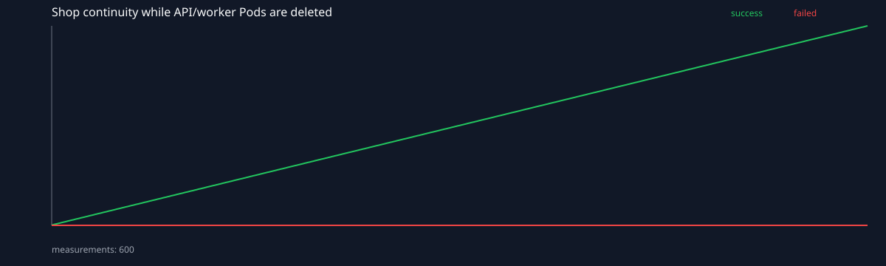
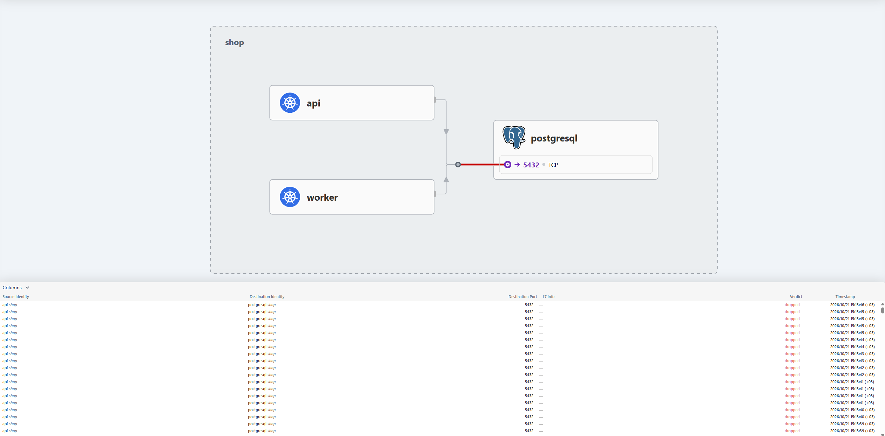
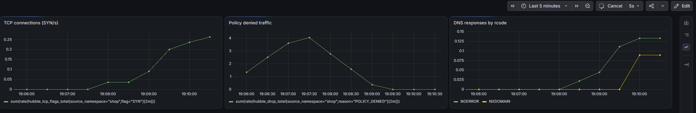

# 5 лабка

Делаем, так называемый, ***Zero Trust сервис.***

> В прошлый раз отчёт разросся почти до тысячи строк, поэтому повторяемые действия
> здесь вынесены в скрипты. В README оставлены команды запуска, результаты и объяснения.


## Часть 0. Выбор CNI

Выбран Cilium. Обе предложенные CNI умеют применять NetworkPolicy, но здесь у Cilium есть решающее преимущество — Hubble. Он понадобится в Части 6, чтобы увидеть заблокированное соединение на карте, а не перебирать правила вслепую.

Кроме этого, Cilium:

- применяет Kubernetes NetworkPolicy в eBPF datapath;
- Hubble показывает L3/L4/L7 flows и причины `DROPPED`;
- при необходимости Cilium умеет L7-policy, хотя в этой лабораторной достаточно L3/L4.

Calico тоже подходит для обычных L3/L4-политик, но отдельная карта трафика делает диагностику в этой работе заметно нагляднее.

Стандартный `kindnet` в [`kind-config.yaml`](kind-config.yaml) отключён:

```yaml
networking:
  disableDefaultCNI: true
  podSubnet: 10.245.0.0/16
  serviceSubnet: 10.97.0.0/16
```

Кластер состоит из control-plane и двух воркер-нод. На control-plane проброшен NodePort `30080`, чтобы API был доступен по `127.0.0.1:30080`.

Установка собрана в [`bootstrap-cluster.sh`](scripts/bootstrap-cluster.sh). Скрипт создаёт kind-кластер `lab5`, устанавливает Cilium с Hubble Relay/UI и CloudNativePG, собирает локальные образы и устанавливает chart `shop`.

Проверка:
```bash
kubectl get nodes
kubectl get pods -n kube-system -o wide | grep -E 'cilium|hubble'
```
Получили по одному Cilium agent и Envoy на каждой ноде; `cilium-operator`, `hubble-relay` и `hubble-ui` находятся в `Running`. После установки CNI все три ноды перешли в `Ready`.

## Часть 1. Развёртывание shop и сеть Pod
> Смотрим, что у нас между Java-процессом в Pod и другим Pod на соседней ноде.

Shop устанавливается Helm-чартом из 3 лабы. Пока мониторинг отключён: его CRD и сетевые метрики подключим в 7 части.
```bash
helm upgrade --install shop helm/shop \
  --namespace shop \
  --create-namespace \
  --set monitoring.enabled=false \
  --wait \
  --timeout 15m
```
Для проверки написан [`inspect-pod-network.sh`](scripts/inspect-pod-network.sh). Он находит готовый API Pod, читает параметры `eth0` из его network namespace, сопоставляет `iflink` с интерфейсом на kind-ноде и выполняет прямой запрос к Pod IP worker на другой ноде.

Результат проверки сети Pod:

```text
API Pod: shop-api-9bd88678d-8wl7w
Pod IP:  10.245.2.16
Node:    lab5-worker

ifindex=10
iflink=11
address=ce:13:4e:de:37:49
mtu=1500

11: lxc697ec234fac7@if10: <BROADCAST,MULTICAST,UP,LOWER_UP> ...
```

`eth0` внутри Pod и `lxc...` на ноде являются двумя концами veth-пары. `iflink=11` внутри Pod совпадает с индексом host-side интерфейса, а `@if10` на ноде указывает обратно на интерфейс внутри network namespace.

Проверка связи между нодами:
```text
shop-api@lab5-worker
  → 10.245.1.230:8081
  → shop-worker@lab5-worker2

{"status":"UP","groups":["liveness","readiness"]}
```
Запрос выполнен непосредственно по Pod IP без Service. Cilium построил межнодовый datapath, поэтому поды видят друг друга в плоской кластерной сети. IP при этом не является стабильной идентичностью: после пересоздания Pod он меняется. Связность проверялась до включения default-deny; в финальном состоянии маршрут `api → worker` уже намеренно запрещён матрицей.

## Часть 2. NodePort и непрерывность при хаосе (как глава книги прям)

### Внешняя точка входа
Тип API Service и NodePort вынесены в `values.yaml`:

```yaml
api:
  service:
    type: NodePort
    port: 8080
    nodePort: 30080
```

Проверяем с хоста:

```bash
curl http://127.0.0.1:30080/health
```

```json
{"status":"ok"}
```

Разница между видами Service:
- **NodePort** открывает один порт на каждой ноде и направляет трафик в endpoints Service. В kind порт дополнительно проброшен из node-контейнера на хост;
- **LoadBalancer** просит внешний контроллер/облако предоставить внешний адрес и обычно строится поверх NodePort;
- **headless Service** имеет `clusterIP: None`: DNS возвращает адреса Pod напрямую, а виртуального IP и балансировки kube-proxy нет.

### Chaos-тест

[`continuity-client.yaml`](tests/continuity-client.yaml) создаёт временный Job. Клиент делает 600 запросов по полному DNS-имени: `shop-api.shop.svc.cluster.local:8080`.

Скрипт [`chaos-pods.sh`](scripts/chaos-pods.sh) каждые 10 секунд выбирает случайный Ready Pod API или worker и удаляет его. Последняя готовая реплика компонента не удаляется: проверяется переключение Service между endpoints.

В Deployment добавлен *graceful drain*:
```yaml
lifecycle:
  preStop:
    exec:
      command: ["/bin/sh", "-c", "sleep 5"]
```
Задержка даёт EndpointSlice и kube-proxy время убрать terminating endpoint до завершения работы JVM.
Полный сценарий и построение SVG-графика находятся в [`run-continuity-test.sh`](scripts/run-continuity-test.sh).

Сценарий сохраняет:
- `artifacts/chaos.log` — какие Pod и когда удалялись;
- `artifacts/continuity.csv` — накопленные success/failed;
- `artifacts/continuity.svg` — график результата.

Результат итогового запуска после настройки graceful drain:
```text
deleted Pods: 9
ok=600 failed=0
```



### Почему Service переживает смену Pod

Цепочка выглядит так:
```text
shop-api.shop.svc.cluster.local
        ↓ CoreDNS
ClusterIP Service
        ↓ kube-proxy rules
Ready addresses из EndpointSlice
        ↓
конкретный Pod IP
```

- CoreDNS преобразует имя Service в его стабильный ClusterIP;
- контроллер EndpointSlice следит за Pod, подходящими под selector Service, и публикует их IP/readiness;
- kube-proxy программирует datapath для ClusterIP/NodePort и выбирает один из готовых endpoints;
- Cilium обеспечивает доставку пакета к Pod, включая другую ноду.

Проверяем режим kube-proxy:
```bash
kubectl get configmap kube-proxy -n kube-system \
  -o jsonpath='{.data.config\.conf}' | grep '^mode:'
```
```text
mode: iptables
```
В режиме iptables Service реализован правилами netfilter. IPVS хранит виртуальные сервисы и destinations в специализированных структурах ядра и предоставляет больше алгоритмов балансировки.

## Часть 3. Целевая матрица доступа
> Сначала описываем разрешённую архитектуру, потом включаем default-deny. А то получится очень безопасная система, в которой очень безопасно ничего не работает.

### Разрешённые соединения

| Источник | Назначение | Порт | Зачем |
| --- | --- | ---: | --- |
| внешний клиент через NodePort | API | TCP 8080 | вход в shop |
| Pod с ролью `client` | API | TCP 8080 | внутренние функциональные/chaos-тесты |
| API | PostgreSQL RW Service | TCP 5432 | создание и чтение заказов |
| worker | PostgreSQL RW Service | TCP 5432 | обработка заказов |
| Prometheus из `monitoring` | API | TCP 8080 | scrape `/metrics` |
| Prometheus из `monitoring` | worker | TCP 8081 | scrape `/metrics` |
| workload shop | kube-dns | UDP/TCP 53 | разрешение имён Service |
| CNPG operator из `cnpg-system` | PostgreSQL instance manager | TCP 8000 | управление Cluster CR |
| PostgreSQL/CNPG | Kubernetes API | TCP 443 | reconciliation instance manager |

### Запрещённые соединения

| Источник | Назначение | Ожидание |
| --- | --- | --- |
| посторонний Pod | PostgreSQL 5432 | deny |
| посторонний Pod | worker 8081 | deny |
| API | worker | deny |
| worker | API | deny |
| API/worker | произвольный интернет | deny |
| любой источник | произвольный порт shop | deny |

Итак, наша policy-модель состоит из двух слоёв:
1. `default-deny` для ingress и egress всех Pod namespace `shop`;
2. точечные allow-policy по labels, namespace labels и конкретным портам.

DNS выделен отдельно, потому что разрешённый TCP-маршрут к PostgreSQL бесполезен, если API не может разрешить имя `shop-postgres-rw`. Аналогично CNPG нельзя ограничить только портом 5432: instance manager должен общаться с оператором и Kubernetes API.

## Часть 4. Включаем zero-trust

Все политики находятся в [`networkpolicies.yaml`](helm/shop/templates/networkpolicies.yaml), а selectors, порты и CIDR вынесены в [`values.yaml`](helm/shop/values.yaml). Применяются они вместе с остальным чартом:

```bash
helm upgrade shop helm/shop -n shop --wait --timeout 10m
```

Базовое правило выбирает все Pod namespace и изолирует оба направления:

```yaml
podSelector: {}
policyTypes: [Ingress, Egress]
```

После этого отдельными allow-policy открыты только:

- DNS — UDP/TCP 53;
- клиент — API:8080;
- API и worker — PostgreSQL:5432;
- Prometheus — `/metrics` API и worker;
- CNPG operator — instance manager:8000;
- PostgreSQL — Kubernetes API.

Последний маршрут дополнительно описан `CiliumNetworkPolicy` через сущность `kube-apiserver`. Она надёжнее одного IP API Server: Cilium может видеть пакет уже после Service DNAT, когда вместо ClusterIP назначением стала control-plane нода.

Проверка созданных правил:

```bash
kubectl get networkpolicy,ciliumnetworkpolicy -n shop
```

Разрешения нескольких `NetworkPolicy` складываются. Если соединение не разрешено ни одним подходящим правилом, оно блокируется.


## Часть 5. Проверка матрицы

[`network-test-pods.yaml`](tests/network-test-pods.yaml) создаёт доверенного клиента с `network-role: network-client` и посторонний Pod без такой роли. Вся матрица запускается одной командой:

```bash
./scripts/check-access-matrix.sh
```

Полученный результат сохранён в [`artifacts/access-matrix.md`](artifacts/access-matrix.md):

```text
| Источник | Назначение | Ожидалось     | Фактически | Результат    |
| api      | api        | не проверяется | allow       | self-traffic |
| api      | worker     | deny           | deny        | OK           |
| api      | postgres   | allow          | allow       | OK           |
| worker   | api        | deny           | deny        | OK           |
| worker   | worker     | не проверяется | deny        | self-traffic |
| worker   | postgres   | allow          | allow       | OK           |
| client   | api        | allow          | allow       | OK           |
| client   | worker     | deny           | deny        | OK           |
| client   | postgres   | deny           | deny        | OK           |
| outsider | api        | deny           | deny        | OK           |
| outsider | worker     | deny           | deny        | OK           |
| outsider | postgres   | deny           | deny        | OK           |
```

Главный результат: API и worker подключаются к БД, а посторонний Pod — нет. Доверенный клиент видит только API. Ячейки `self` не участвуют в проверке архитектуры: трафик процесса к самому себе может вообще не покидать network namespace и не обязан проходить через NetworkPolicy.

## Часть 6. Скрытая поломка

В `values.yaml` предусмотрен параметр `networkPolicy.fault`. Скрипт [`inject-network-fault.sh`](scripts/inject-network-fault.sh) случайно выбирает одну из четырёх поломок:

| Значение | Что ломается |
| --- | --- |
| `dns` | убирается разрешение DNS |
| `postgresSelector` | выбирается несуществующий PostgreSQL |
| `postgresPort` | разрешается неверный порт 15432 |
| `apiSelector` | перестаёт совпадать label клиента |

Запускаем поломку, не подсматривая выбранное значение:

```bash
./scripts/inject-network-fault.sh
```

В тестовом запуске новые API/worker перестали подключаться к PostgreSQL. Вместо перебора YAML смотрим отбрасываемые пакеты на всех Cilium agent:

```bash
for pod in $(kubectl get pod -n kube-system -l k8s-app=cilium -o name); do
  kubectl exec -n kube-system "$pod" -- \
    hubble observe --namespace shop --verdict DROPPED --since 5m --last 20
done
```

Hubble показал обращения API к `shop-postgres-1:5432` с вердиктом `Policy denied`. DNS при этом работал, а SYN-пакеты до PostgreSQL отбрасывались политикой. Проверка скрытого значения подтвердила `fault=postgresPort`: policy ошибочно разрешала порт 15432 вместо 5432.

Для повторяемого скриншота можно принудительно выбрать именно поломку порта PostgreSQL. Обычный запуск по-прежнему выбирает вариант случайно:

```bash
FAULT=postgresPort FAULT_FOR_REPORT=1 ./scripts/inject-network-fault.sh

kubectl port-forward -n kube-system svc/hubble-ui 12000:80
```

В Hubble UI выбираем namespace `shop`, фильтруем вердикт `DROPPED` и находим связь API с `shop-postgres-1:5432`. На карте видны источник, назначение, порт 5432 и строки с вердиктом `dropped`.



Исправление и повторная проверка:

```bash
./scripts/repair-network.sh
```

Скрипт возвращает `fault=none` и заново прогоняет матрицу. После исправления она снова стала полностью зелёной, а новый заказ успешно прошёл путь API → PostgreSQL → worker. Таким образом, причина найдена по наблюдаемому заблокированному соединению, а не подбором правил.

## Часть 7. Мониторинг сети

Используется тот же `kube-prometheus-stack`, что и во второй лабораторной. Конфигурация переиспользована, но установлена в lab5-кластер: CRD, ServiceMonitor и discovery Prometheus относятся к конкретному Kubernetes-кластеру. Установка и включение метрик Cilium выполняются скриптом:

```bash
./scripts/install-monitoring.sh
```

Cilium и CoreDNS публикуют сетевые метрики. Prometheus Operator читает соответствующие `ServiceMonitor` и настраивает Prometheus на их сбор:

- `hubble_tcp_flags_total` — TCP SYN/RST;
- `hubble_drop_total` — отброшенные пакеты и причина;
- `coredns_dns_requests_total` и `coredns_dns_responses_total` — DNS-запросы, ответы и `rcode`.

В чарт добавлен Grafana dashboard [`grafana-dashboard.yaml`](helm/shop/templates/grafana-dashboard.yaml) с графиками TCP-соединений, policy denied и DNS-ответов. ConfigMap автоматически подхватывается dashboard-sidecar Grafana.

```bash
kubectl port-forward -n monitoring svc/monitoring-grafana 3000:80
kubectl get secret monitoring-grafana -n monitoring \
  -o jsonpath='{.data.admin-password}' | base64 -d; echo
```

После входа dashboard доступен по `http://127.0.0.1:3000/d/shop-network/shop-network`.

На итоговом dashboard одновременно видны TCP-соединения, трафик с вердиктом policy denied и DNS-ответы по `rcode`.



В [`prometheusrule.yaml`](helm/shop/templates/prometheusrule.yaml) находятся три алерта:

| Алерт | Условие | Зачем |
| --- | --- | --- |
| `ShopNetworkPolicyDrops` | появился `POLICY_DENIED` из `shop` | обнаруживает поломанные маршруты и подозрительный трафик |
| `ShopDnsErrors` | CoreDNS возвращает `SERVFAIL` | без DNS недоступны обращения по Service name; обычный `NXDOMAIN` алертом не считается |
| `ShopTcpResets` | частота TCP RST выше порога | замечает недоступный backend и аварийные разрывы |

Алерт на заблокированный трафик проверен посторонним Pod:

```bash
./scripts/trigger-policy-alert.sh
```

Скрипт пытается обратиться к worker по Pod IP, что запрещено матрицей. Cilium зафиксировал реальный drop:

```text
shop/outsider <> shop/shop-worker:8081 EGRESS DENIED (TCP Flags: SYN)
```

Состояние правил проверялось через Prometheus API:

```bash
kubectl port-forward -n monitoring \
  svc/monitoring-kube-prometheus-prometheus 9090:9090

curl -s 'http://127.0.0.1:9090/api/v1/rules?type=alert' | jq -r '
  .data.groups[].rules[]
  | select(.name | startswith("Shop"))
  | [.name, .state, (.alerts | length)]
  | @tsv
'
```

Итог:

```text
ShopNetworkPolicyDrops  firing   1
ShopDnsErrors           inactive 0
ShopTcpResets           inactive 0
```

После прекращения запрещённых запросов rate обнулился, и алерт вернулся в `inactive`. Доказательства запуска сохранены в [`network-alert.txt`](artifacts/network-alert.txt) и [`hubble-diagnosis.txt`](artifacts/hubble-diagnosis.txt).
