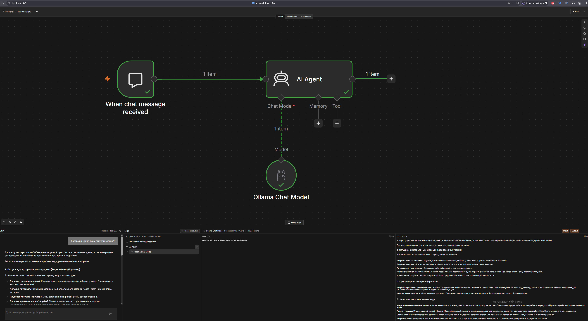
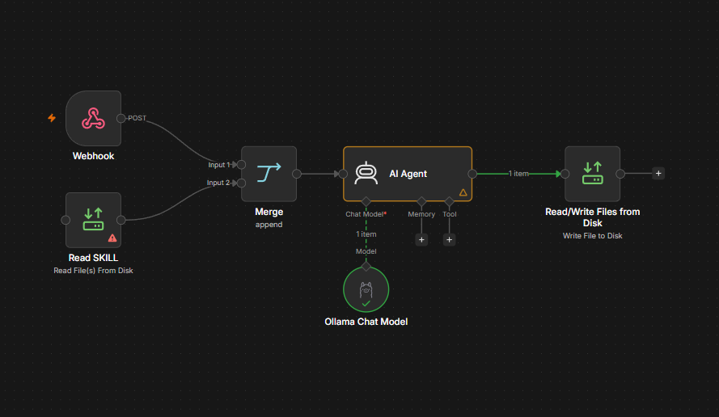
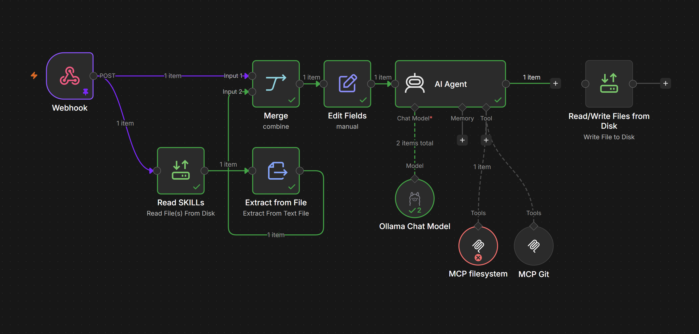
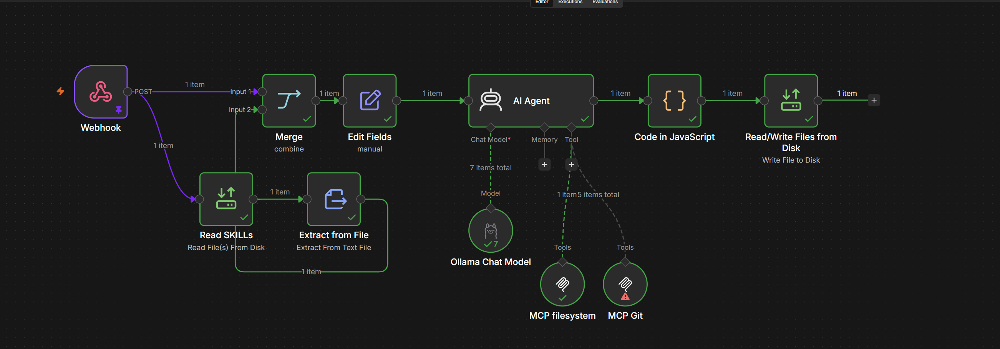
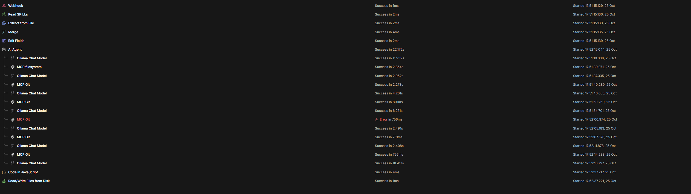
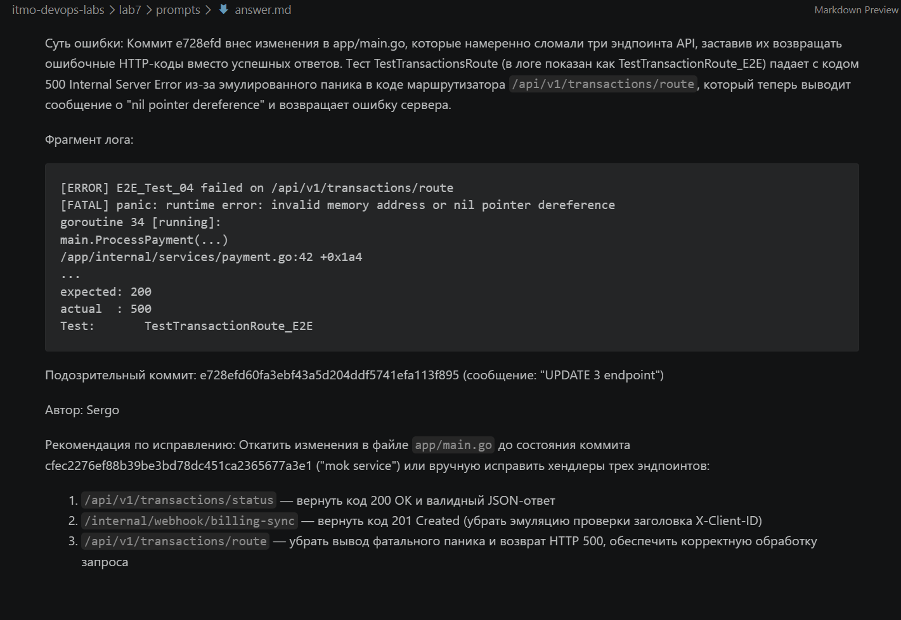
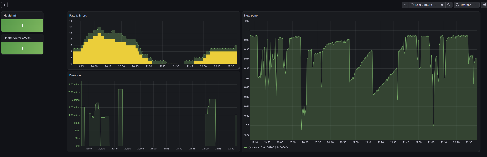
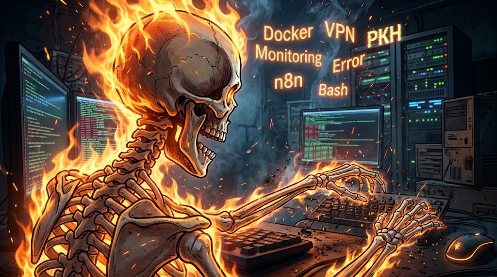

# Лаба 8 — Автоматизация процесса E2E тестирования с n8n + AI
## Часть 1 — Придумываем кейс
### Контекст

```...опиши компанию, проект и людей, которые там работают...```

За проект возьмем B2B компанию "Barnyard", у которой есть несколько микросервисов на Go, связанные между собой по gRPC, инфра развернута в Kubernetes. Так как в компании высокая связность сервисов, то регулярно проводится сквозное тестирование.

 

*Надеюсь шутка про "Рога и Копыта" была понята..*

### Кому это помогает — всем или конкретной команде?

Так как отладка кода порой отнимает много времени и требует частой смены контекста при анализе, было решено внедрить QA-ассистента, который снизит нагрузку на разработчиков, выполняя первичный анализ проваленных тестов, сразу выдавая рекомендации и место, где есть предполагаемые виновники сбоя.


### Какую проблему решает и почему сейчас это неудобно делать руками?

Как это устроено в Barnyard сейчас:
- разработчик пушит свои коммиты
- CI запускает сквозное тестирование на ночь
- утром разработчик видит красный статус сборк в гитлабе, наливает кофейку и идет разбираться. А что ему нужно сделать? 
    - ищет лог упавшего E2E-теста
    - ищет логи пода микросервиса
    - ищет трейсы, связанные с ошибкой
    - найдя конкретную ошибку, сопоставляет его с конкретной строчкой нового кода

Мы видим, что для того, чтобы исправить баг, нужно нудно копаться в логах, попутно стараясь не растерять внимание.

### Что именно делает автоматизация от начала до конца: триггер → шаги → результат?

И тут на помощь проходит наш QA-ассистент. 

После падения тестов в E2E, CI отправляет вебхук с JSON в нашего QA-ассистента. Ассистент сам отправляет запрос в Kibana, чтобы собрать логи и трейсы пода с багованным кодом. Анализирует их и ищет, какое именно место в измененном коде привело к ошибке. Далее собирает резюме в `.md` файл и отправляет его в проектный чат разработчика.

```
Вебхук от CI/CD -> Парсинг и фильтрация -> Запрос логов -> Запрос кода -> Анализ и сопоставление -> Формирование отчёта
```
## Часть 2 — План реализации

### Триггер
Итак, пойдем разбирать детальнее. 

Устанавливаем n8n и запускаем в локально в докере. Создам докер-файл:
``` yaml
services:
  n8n:
    image: docker.n8n.io/n8nio/n8n
    container_name: n8n_e2e_lab
    restart: unless-stopped
    ports:
      - "127.0.0.1:5678:5678"
    environment:
      - N8N_HOST=localhost
      - N8N_PORT=5678
      - N8N_PROTOCOL=http
      - NODE_ENV=production
      - WEBHOOK_URL=http://localhost:5678/
    volumes:
      - n8n_data:/home/node/.n8n

volumes:
  n8n_data:
```

У меня есть мой рабочий ПК, с Windows, VS code и мощной видеокартой - которая тянет Qwen-27b через Ollama. 

А сам сервер с докером и лабами находится на другом ПК, подключенном локально. Для этой лабы прокинул порты по следующей схеме:
```
подключение через VS Code к ПК-серверу по ssh -> запуск n8n и прокинутый порт 5678 до рабочего ПК -> запуск на рабочем ПК графической оболочки n8n и Ollama на стандартном порту -> прокинутый порт Ollama в ПК-сервер
```

Делаю тестовый воркфлоу:

 

Всё сработало! Но, конечно, т.к. нейронка локальная, то и ждать ответ пришлось пару минут.

Далее создам тестовый репозиторий с моковым http-api, который отдает на разные эндпойнты ответы:

```
/api/v1/transactions/status - 200

/internal/webhook/billing-sync - 201

/api/v1/transactions/route - 500
```

Далее мы зальем коммит с изменением кода на возврат других ответов и посмотрим, как поведёт себя наш воркфлоу.

###  Какие шаги должен сделать наш воркфлоу?
- **(CODE)** принять вебхук
- **(AI)** передать контекст AI-агенту (внутри n8n), который автономно вызывает инструменты для сбора логов, анализа диффов кода и формирования вывода.
- **(CODE)** создать отчёт по ошибке и записать его в файл

 

Собрал такой воркфлоу. Также подключил ноду для чтения скиллов, которые буду настраивать дальше. 

### MCP-серверы
* **GitHub MCP:** Предоставляет агенту доступ к репозиторию проекта для чтения последних коммитов, авторов и измененных строк кода.
* **Filesystem MCP:** Дает доступ к локальной файловой системе. Для локального запуска лабы он будет эмулировать логи Kubernetes, читая заранее заготовленные `.log` файлы микросервисов из папки на диске.

Для того, чтобы подключить необходимые MCP, их нужно запустить на нашем сервере. Для этого поправлю докер компоуз ямлик и добавлю наши MCP ноды на воркфлоу. 

Так как мы подключили volume, то наши данные хранятся там и при перезапуске не потеряются. 

Тут конечно были сложности, т.к. MCP упорно не хотел запускаться. Но итоге было до безумия смешно - пока поле выбора инструментов MCP было заморожено, нужно было просто подождать ответ от n8n и они подгрузятся. А я то думал - чего это http запросы проходят, а инструментов почему-то нет))

### AI Toolkit (Инструменты агента)

Теперь посмотрю инструменты и выберу необходимые мне:
- Для того, чтобы агент получил доступ к файлу с логами, ему нужен инструмент для чтения с диска (читаем мок): `read_file` и для ориентирования в директориях `list_allowed_directories`
- Также агенту нужно будет уметь записать куда-то наш ответ: `write_file`
- Для работы с гитом, ему потребуются инструменты: 
  - `git_log` - чтобы получить хэш последнего коммита
  - `git_diff`- узнать где изменён код

### Описанные skills и входные данные

Создам файл с [описанием скиллов агента](./prompts/SKILLs.md) и последовательностью действий. Чтобы добавить файл в воркфлоу, мне нужно пробросить его в n8n. Для этого добавлю папку `/prompts` в ямлик и обновлю контейнер.

По пути поправлю воркфлоу - добавлю чтение файла и экспорт из него в JSON, на который сошлюсь в `System message` агента. 

В качестве триггера у нас POST запрос, подставлю в ноде моковое тело. И дальше я столкнулся с проблемой, что я не мог выбрать в агенте нужные джейсон поля. 

Всё решилось добавлением ноды `Merge`, которая соединила в себе все данные, которые мы разметили далее в `Edit Fields` и одним запросом передаём в агента.

Получаем такой воркфлоу. На МСП пока не смотрим - он выдает ошибку, т.к. у нас пока нет данных с логами. 

 

### Моковые логи и запись файла.

Добавим папку с логами, куда будет ходить наш агент за сбором информации. Также добавлю сохранение ответа в `md` файл в том `prompts`. 

Так как нода записи требует бинарный поток на вход, добавлю небольшой скрипт, преобразующий ответ агента в бинарник.

### Перечислю наши моковые данные:
- моковый репозиторий https://github.com/Sergey-Shikhaylo/containerization-and-orchestration-lab8-mok
- моковое тело POST запроса
- моковый файл с логами
- тестовый http-api 
- коммит с обновлением http-api, который теперь вызывает ошибку

## Проверка агента

Вот такой у нас получился итоговый паплайн и пробую его запустить. 

*В прошлой попытке была проблема, что MCP-git не мог пользоваться инструментами, т.к. UID докера отличался от UID владельца репозитория. Пофиксил строчкой в докеркомпоузе, разрешив сторонним пользователям работать с репой.*

*Еще и MCP падал все время, тут помогло увеличить таймаут ожидания. Сразу как часики заработал*

 

Обалдеть, ему MCP отдел ошибку, что он забыл указать хэш коммита при запросе `git_diff`. Агент сам нашел хэш коммита и перезапустил `git_diff`.

 

И ответ записан в [answer.md](./prompts/answer.md), ура!

 

Отлично, всё замечательно работает!

## Мониторинг

Дополняем наш докер компоуз, разворачиваем Victoria Metrics и Grafana. 

И теперь думаем, какие метрики будут нам полезны.

Точно нужны метрики RED:
- Rate

  Это количество обращений к агенту в час. Если частота резко возрастает, то выше расход на токены и высокий уровень ошибок у разработки.
  ```SQL
  sum(changes(n8n_workflow_execution_duration_seconds_count[1h]))
  ```
- Errors

  Необходимо сравнивать долю неудачных попыток агента провести анализ. Вплеск метрики может означать нарушения связности сервисов.
  ```SQL
  sum(changes(n8n_workflow_execution_duration_seconds_count{status="failed"}[1h]))
  ```
- Duration

  Просто считаем общее время выполнения запроса, от приема вебхука до записи файла в систему.
  Если время запроса увеличивается, значит либо наша модель уже не справляется со сложностью, либо падение воркфлоу.
  ```SQL
  sum(rate(n8n_workflow_execution_duration_seconds_sum[5m])) / sum(rate(n8n_workflow_execution_duration_seconds_count[5m]))
  ```
- Полезно будет чекать доступность n8n и Victoria Metrics. В случае если упало - алерт.
  ```SQL
  up{job="n8n"}
  ```

  ```SQL
  count(process_start_time_seconds)
  ```

- Также стоит следить за количеством свободной памяти у n8n, если вся память скоро забьётся - это повод для алерта.

  ```SQL
  n8n_nodejs_heap_size_used_bytes / n8n_nodejs_heap_size_total_bytes
  ```

 

## Финальная сверка
- [README.md](README.md) — есть
- [Экспорт workflow из n8n](./export_n8n/Workflow.json)
- [AI skills](./prompts/SKILLs.md)
- Графики мониторинга есть и выбранные алерты тоже 
- AI toolkit описан

## И немного жизы, как я писал эту лабу в погоне за пятёркой для команды

 